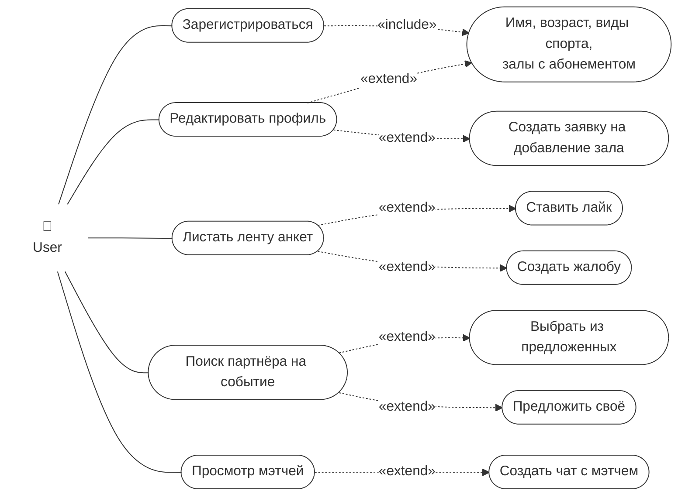
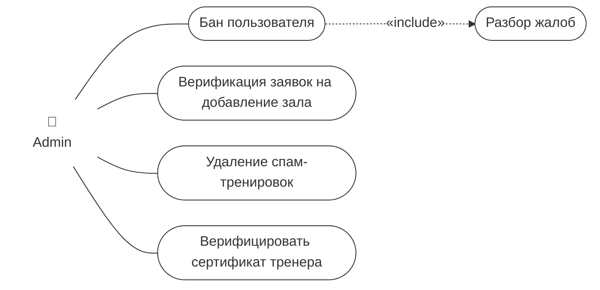
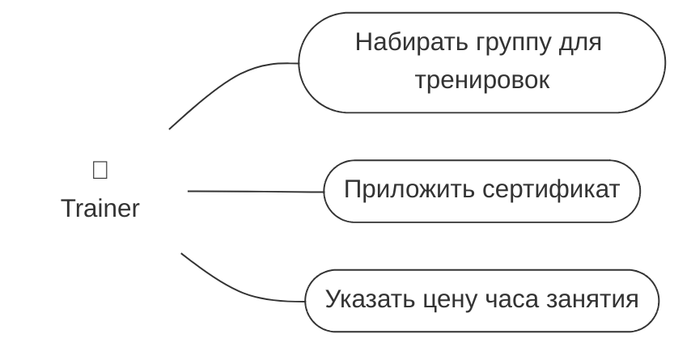
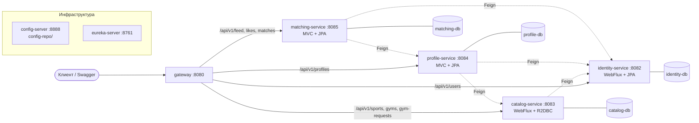
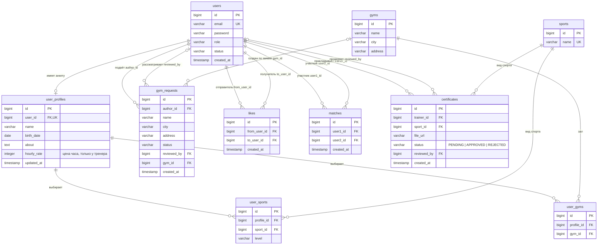

# GymBro

GymBro - это REST API для поиска партнёров по тренировкам. Пользователи
заполняют анкеты, выбирают виды спорта и залы, просматривают ленту и ставят лайки.
Взаимный лайк создаёт мэтч, как в Тиндере.

Система разделена на микросервисы (см. «Микросервисы» и «Запуск» ниже).
Общий Swagger UI через gateway: http://localhost:8080/swagger-ui.html

## Акторы

| Актор | Описание |
|-------|----------|
| **User** | Пользователь, который ищет напарника для занятий спортом |
| **Trainer** | Тренер, набирающий группы для тренировок (требуется подтверждённый сертификат) |
| **Admin** | Администратор, модерирующий пользователей, залы, тренировки и сертификаты |

### User



### Admin



### Trainer




## Микросервисы

С лабораторной работы №2 система разделена на микросервисы. Клиент обращается только
к gateway на порту 8080. Сервисы находят друг друга через Eureka, а настройки берут
из Config Server.



| Сервис | Что делает | Стек | Порт |
|---|---|---|---|
| `config-server` | Отдаёт настройки из папки `config-repo/` (режим `native`): общий `application.yml` и `<сервис>/application-dev.yml` для профиля `dev` | Spring Cloud Config | 8888 |
| `eureka-server` | Реестр сервисов | Spring Cloud Netflix Eureka | 8761 |
| `gateway` | Единственный вход: маршруты `lb://<сервис>`, Circuit Breaker на каждый сервис, общий Swagger | Spring Cloud Gateway (WebFlux) | 8080 |
| `identity-service` | Учётные записи, роли, статусы, вход и выдача JWT, сертификаты тренеров; мягкое удаление | **Reactor + Spring Data JPA** | 8082 |
| `catalog-service` | Виды спорта, залы, заявки на залы | **Reactor + R2DBC** | 8083 |
| `profile-service` | Анкеты, виды спорта с уровнем и залы в анкете, подбор кандидатов в ленту | Spring MVC + JPA | 8084 |
| `matching-service` | Лента, лайки, мэтчи | Spring MVC + JPA | 8085 |

### Как сервисы общаются

- У каждого сервиса **своя база** в своём контейнере PostgreSQL и свой changelog Liquibase.
  Внешних ключей между базами нет: соседние сущности хранятся как обычные идентификаторы.
  Поэтому пользователь удаляется мягко (флаг `deleted`), без каскада.
- Соседей вызывают через **Feign**, клиенты лежат в пакете `<сосед>.client`. Сервис-владелец
  отдаёт данные через внутренние эндпоинты `/internal/v1/...`. Gateway их наружу не
  пропускает, в Swagger их тоже нет. Ответы — записи `XxxSnapshot`, а не сущности.
- `RemoteCalls` переводит ответы соседа в исключения: 4xx становятся доменными
  исключениями (404 → «не найдено»), а 5xx, таймауты и открытый автомат —
  503 «Сервис временно недоступен».

### Circuit Breaker (Resilience4j)

- **На Feign-клиентах.** Автомат размыкается, если из последних 10 вызовов соседа
  (минимум 5) половина закончилась сбоем. Через 10 секунд он пропускает 2 пробных запроса.
  Ответы 4xx сбоем не считаются. Таймаут Feign — 3 с.
- **Fallback ленты.** Если profile-service недоступен, matching отдаёт пустую страницу
  ленты вместо ошибки. Если недоступны identity или catalog, отвечаем 503 с понятным текстом.
- **В gateway.** У каждого маршрута свой автомат. Если сервис не отвечает или его нет
  в Eureka, gateway сразу отдаёт 503 из `/fallback/<сервис>`, а остальные сервисы
  продолжают работать.

### Reactor

- **catalog-service — Reactor + R2DBC.** Весь путь от контроллера до базы неблокирующий
  (`Mono`/`Flux`, `R2dbcRepository`). Liquibase умеет только JDBC, поэтому миграции идут
  отдельным подключением при старте. Блокирующий Feign-вызов в identity вынесен на
  `Schedulers.boundedElastic()`.
- **identity-service — Reactor + Spring Data JPA.** Контроллеры и сценарии возвращают `Mono`,
  а каждое обращение к JPA-репозиторию выполняется через `BlockingJpa`: `TransactionTemplate`
  внутри `Mono.fromCallable(...).subscribeOn(Schedulers.boundedElastic())`. Так блокирующий
  JDBC не занимает потоки event loop.
- В обоих сервисах текущий пользователь (субъект JWT) берётся из `ReactiveSecurityContextHolder`
  в контексте Reactor, а не из потока запроса.

### Слои внутри сервиса

- `web` отвечает за HTTP-методы, пути, входную валидацию и статусы ответа.
- `dto` описывает запросы и ответы. Entity напрямую в HTTP не отдаётся;
  например, пароль отсутствует в `UserResponse`.
- `api` — интерфейсы сценариев для контроллеров и контракты (`XxxDirectory`, `XxxSnapshot`) для соседей.
- `service` проверяет права и бизнес-условия, задаёт границы транзакций.
- `model` содержит сущности, enum и инварианты.
- `repository` — Spring Data репозитории (JPA или R2DBC).
- `client` — Feign-клиенты соседних сервисов.
- `shared` (своя копия в каждом сервисе) — ошибки, текущий пользователь, пагинация, OpenAPI.

## Авторизация и роли

### Как получить токен

Пользователей создаёт только администратор (супервайзер), самостоятельной регистрации нет.
Первый администратор создаётся миграцией: `admin@gymbro.local` / `admin12345`.

```bash
curl -X POST http://localhost:8080/api/v1/auth/login \
     -H 'Content-Type: application/json' \
     -d '{"email":"admin@gymbro.local","password":"admin12345"}'
# {"accessToken":"eyJ...","tokenType":"Bearer","expiresIn":3600}
```

Токен передаётся в заголовке `Authorization: Bearer <accessToken>`, в Swagger — кнопка Authorize.
Это JWT, подписанный HS256 общим секретом `JWT_SECRET_BASE64`: `sub` — id пользователя,
`role` — роль, `iss` — `gymbro-identity`, срок жизни — 1 час. Заголовок `X-User-Id`
больше не работает.

### Кто проверяет токен

- Токен выдаёт только identity-service. Проверяет его **каждый сервис сам**: Spring Security
  в режиме resource server с тем же секретом. Gateway просто передаёт заголовок дальше, поэтому
  прямой запрос к сервису в обход gateway тоже требует токен.
- Без токена доступны: вход, чтение справочника видов спорта и залов, `/internal/**`
  (межсервисные вызовы, наружу через gateway не маршрутизируются), health и Swagger.
- Отказы Spring Security приходят тем же ProblemDetail, что и остальные ошибки:
  401 с `WWW-Authenticate: Bearer` — нет токена, токен истёк, подпись или issuer чужие;
  403 — не хватает прав.

### Пароли

Пароли хранятся только как хэш BCrypt (миграция `03-password-hashes.yaml` перехэшировала
старые записи). Ни один ответ API, где участвует пользователь, пароль не содержит:
`UserResponse`, токен и снимки для соседних сервисов его не включают.

### Роли

Роль хранится в `users.role` и попадает в токен при входе.

| Действие | USER | TRAINER | ADMIN |
|---|:---:|:---:|:---:|
| Своя анкета, лента, лайки, мэтчи, заявка на зал | ✓ | ✓ | ✓ |
| Приложить сертификат тренера | ✓ | ✓ | — |
| Указать цену часа занятия | — | ✓ | — |
| Читать, менять, удалять свою учётную запись | ✓ | ✓ | ✓ |
| Создавать пользователей, видеть их список, назначать роли USER/ADMIN | — | — | ✓ |
| Читать, менять, удалять чужую учётную запись | — | — | ✓ |
| Менять справочник видов спорта и залов | — | — | ✓ |
| Рассматривать заявки на залы | — | — | ✓ |
| Верифицировать сертификаты тренеров | — | — | ✓ |

Права проверяются на двух уровнях. Грубо — по роли из токена в фильтре Spring Security
(`hasRole`). Точно — в сервисе по актуальной роли и статусу из identity. Поэтому
заблокированный или разжалованный пользователь теряет права сразу, даже со старым токеном,
а новые права после повышения появляются, когда пользователь войдёт заново.

### Как стать тренером

1. Пользователь прикладывает сертификат или диплом: `POST /api/v1/certificates`
   с `sportId` и ссылкой `fileUrl` на скан. Сертификат получает статус PENDING; по одному
   виду спорта на проверке может быть только один сертификат. Свои сертификаты —
   `GET /api/v1/certificates/me`.
2. Администратор видит очередь `GET /api/v1/certificates?status=PENDING` (общее количество —
   в `X-Total-Count`) и одобряет (`POST /api/v1/certificates/{id}/approve`) или отклоняет
   (`.../reject`) сертификат.
3. При одобрении пользователь получает роль TRAINER (транзакция №3). Напрямую назначить
   TRAINER нельзя — только через одобренный сертификат; снять роль можно, назначив USER.
4. Тренер указывает цену часа: `PUT /api/v1/profiles/me/hourly-rate` с `{"hourlyRate": 1500}`
   (рубли, от 1 до 100 000; `null` убирает цену).
5. В анкете (`GET /api/v1/profiles/{userId}`) и в карточке ленты тренер выделен блоком
   `"trainer": {"certificateVerified": true, "hourlyRate": 1500}`. У остальных блока нет.
   Если identity временно недоступен, анкета и лента показываются без этого блока.

Файл сертификата пока передаётся ссылкой; загрузка файлов появится вместе с файловым
сервисом. Сценарий «Набирать группу для тренировок» в проект пока не входит.

## Запуск

Нужен Docker. Из корня проекта:

```bash
docker compose up --build -d
```

Первая сборка занимает несколько минут: собираются 7 образов, зависимости кешируются
между сборками. Compose сам соблюдает порядок запуска: базы → config-server и eureka →
сервисы → gateway. Примерно через 30 секунд после старта сервисы находят друг друга
через Eureka.

| Что | Адрес |
|---|---|
| Общий Swagger (переключатель сервисов справа сверху) | http://localhost:8080/swagger-ui.html |
| Eureka (зарегистрированные сервисы) | http://localhost:8761 |
| Базы identity / catalog / profile / matching | `localhost:5434` / `5435` / `5436` / `5437` |

Все настройки окружения лежат в `.env` в корне проекта (в git его нет). Перед первым запуском
скопируйте шаблон `.env.example` в `.env` и впишите ключ подписи токенов `JWT_SECRET_BASE64`:
без него compose не стартует. Ключ можно сгенерировать командой `openssl rand -base64 32`.
Как получить токен — в разделе «Авторизация и роли».

Тот же `.env` читают сервисы, запущенные из IDE (конфигурации в `.run/`): identity, catalog,
profile и matching подключают его через `spring.config.import: optional:file:.env[.properties]`.
Поэтому секрет, логины, пароли и порты баз берутся из одного места и в Docker, и в IDE.
В Docker-образ `.env` не попадает, там значения передаёт docker-compose.

Проверка Circuit Breaker: `docker compose stop profile-service`. Лента
(`GET /api/v1/feed`) вернёт пустую страницу, а `GET /api/v1/profiles/{id}` — 503 из fallback
gateway. После `docker compose start profile-service` всё восстанавливается.

Остановить стек: `docker compose down`. Остановить и стереть базы: `docker compose down -v`.

Тесты (нужен Docker для Testcontainers) и проверка покрытия не ниже 70% в каждом модуле:

```bash
./gradlew check
```

## Схема БД

Ниже логическая схема всей предметной области. Физически таблицы разнесены по базам
сервисов: `users` и `certificates` лежат в identity-db, `sports`, `gyms` и `gym_requests` — в catalog-db,
`user_profiles`, `user_sports` и `user_gyms` — в profile-db, а `likes` и `matches` — в matching-db.
Связи между таблицами разных баз — это обычные идентификаторы без внешних ключей, их целостность
проверяет код через вызовы соседнего сервиса. Внешние ключи остались только внутри одной базы.



Типы связей:

- One-to-Many / Many-to-One: пользователь и его заявки на залы (`gym_requests.author_id`), пользователь и лайки (`likes.from_user_id`, `likes.to_user_id`), пользователь и его сертификаты (`certificates.trainer_id`).
- Many-to-Many: анкеты и залы через `user_gyms`.
- Many-to-Many с дополнительным полем: анкеты и виды спорта через `user_sports.level`.
- Дополнительно One-to-One: учётная запись и необязательная анкета.

## Эндпоинты

Префикс всех путей — `/api/v1`. 
Эндпоинты см в Swagger: http://localhost:8080/swagger-ui.html

### Пагинация

Для всех HTTP-списков: `page=0` по умолчанию, `size=20`, максимум 50. Завышенный
size урезается до 50. В MVC-сервисах это делают свойства `spring.data.web.pageable` из
`config-repo/application.yml`, в WebFlux-сервисах — `WebFluxConfiguration`.

## Транзакции

### №1: одобрение заявки на зал

`GymRequestService.approve` в catalog-service — реактивная транзакция R2DBC
(`TransactionalOperator`):

1. До транзакции проверяет активного администратора: это вызов identity, и он не должен
   держать подключение к базе.
2. Блокирует строку заявки (`SELECT ... FOR UPDATE`) и проверяет статус PENDING.
3. Проверяет отсутствие зала по городу и адресу.
4. Создаёт зал.
5. Сохраняет APPROVED, reviewedBy и gymId в заявке.

Если сохранение решения падает, INSERT зала откатывается, иначе мог бы остаться
зал с незакрытой заявкой.

### №2: лайк и взаимное совпадение

`MatchingService.like` в matching-service выполняется под `@Transactional`:

1. Определяет отправителя и проверяет получателя, запрещает лайк самому себе.
2. Получает транзакционную advisory-блокировку PostgreSQL для пары пользователей.
3. Проверяет отсутствие повторного лайка и сохраняет его.
4. Ищет встречный лайк; если он есть, находит или создаёт Match.

Без согласования два встречных запроса могли бы оба не увидеть ещё не
зафиксированный встречный лайк, и совпадение не появилось бы. Одна транзакция
обеспечивает атомарность лайка и совпадения.

### №3: одобрение сертификата тренера

`CertificateService.approve` в identity-service — транзакция JPA через `BlockingJpa`
(`TransactionTemplate` на `boundedElastic`):

1. До транзакции проверяет активного администратора.
2. Блокирует строку сертификата (`SELECT ... FOR UPDATE`) и проверяет статус PENDING.
3. Проверяет, что автор не заблокирован и не удалён.
4. Сохраняет APPROVED и reviewedBy в сертификате и меняет роль автора USER → TRAINER.

Роль не должна смениться без одобренного сертификата, а одобренный сертификат — остаться
без роли. Блокировка не даёт двум администраторам рассмотреть один сертификат одновременно.

### Обновления профиля

Изменение полей и коллекций анкеты также транзакционно. Для существующего профиля
перед изменением берётся блокировка строки. 

## Ошибки

Общий `ApiExceptionHandler` возвращает ProblemDetail (`status`, `title`, `detail`).
Для ошибок полей добавляется `errors`. Статусы: 400 — некорректные данные;
401 — нет действительного Bearer-токена или пользователь из токена не найден;
403 — недостаточно прав для роли или пользователь заблокирован; 404 — объект не найден; 409 — дубликат или конфликт состояния;
500 — неожиданная внутренняя ошибка; 503 — соседний сервис недоступен (ответ сервиса
или fallback gateway). 

