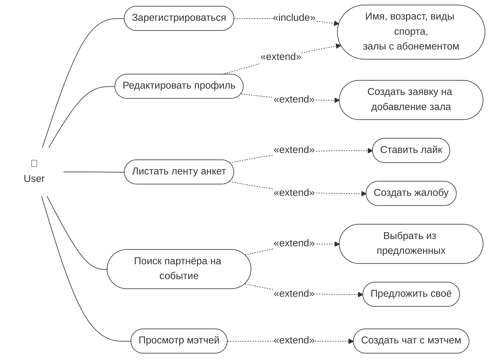
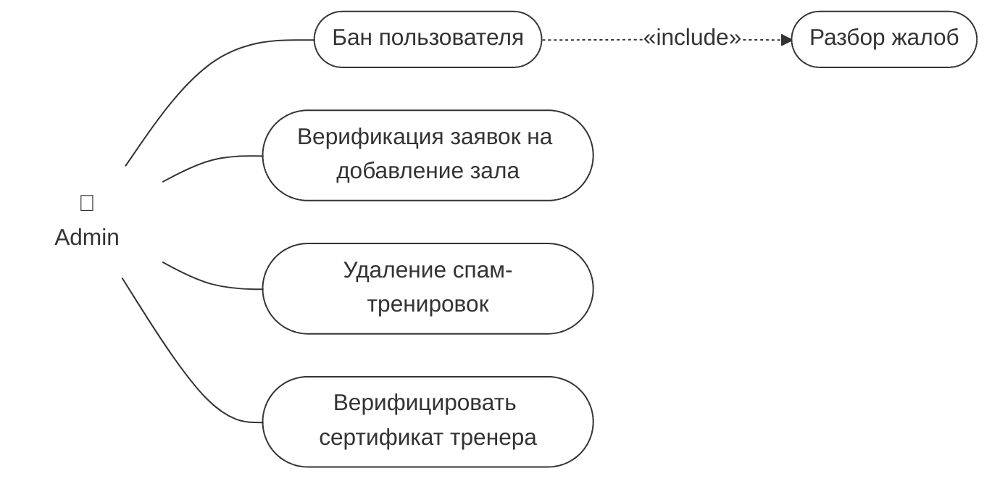
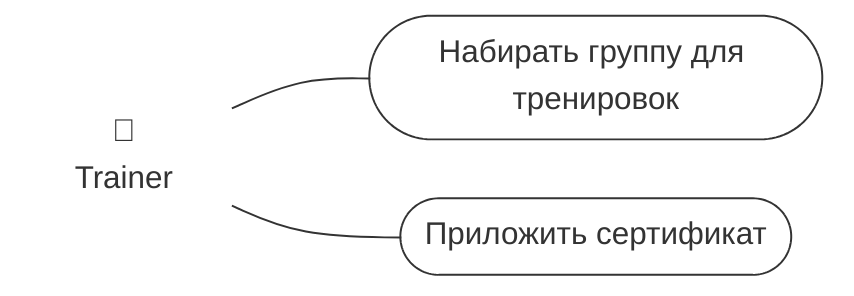
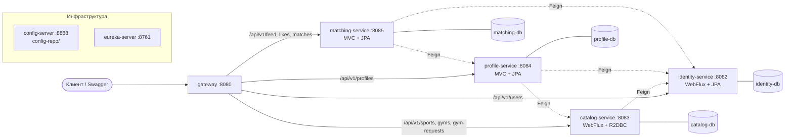
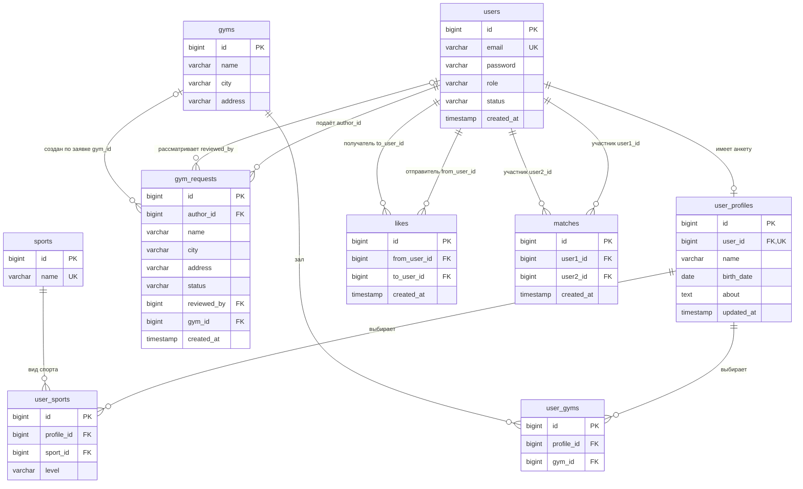

# GymBro

GymBro - это REST API для поиска партнёров по тренировкам. Пользователи
заполняют анкеты, выбирают виды спорта и залы, просматривают ленту и ставят лайки.
Взаимный лайк создаёт мэтч, как в Тиндере.

Система разделена на микросервисы (см. «Микросервисы» и «Запуск» ниже).
Общий Swagger UI через gateway: http://localhost:8080/swagger-ui.html

## Акторы

| Актор | Описание |
|-------|----------|
| **User** | Пользователь, который ищет напарника для занятий спортом |
| **Trainer** | Тренер, набирающий группы для тренировок (требуется подтверждённый сертификат) |
| **Admin** | Администратор, модерирующий пользователей, залы, тренировки и сертификаты |

### User



### Admin



### Trainer




## Микросервисы

С лабораторной работы №2 система разделена на микросервисы. Клиент обращается только
к gateway на порту 8080. Сервисы находят друг друга через Eureka, а настройки берут
из Config Server.



| Сервис | Что делает | Стек | Порт |
|---|---|---|---|
| `config-server` | Отдаёт настройки всех сервисов из папки `config-repo/` (режим `native`) | Spring Cloud Config | 8888 |
| `eureka-server` | Реестр сервисов | Spring Cloud Netflix Eureka | 8761 |
| `gateway` | Единственный вход: маршруты `lb://<сервис>`, Circuit Breaker на каждый сервис, общий Swagger | Spring Cloud Gateway (WebFlux) | 8080 |
| `identity-service` | Учётные записи, роли, статусы; мягкое удаление | **Reactor + Spring Data JPA** | 8082 |
| `catalog-service` | Виды спорта, залы, заявки на залы | **Reactor + R2DBC** | 8083 |
| `profile-service` | Анкеты, виды спорта с уровнем и залы в анкете, подбор кандидатов в ленту | Spring MVC + JPA | 8084 |
| `matching-service` | Лента, лайки, мэтчи | Spring MVC + JPA | 8085 |

### Как сервисы общаются

- У каждого сервиса **своя база** в своём контейнере PostgreSQL и свой changelog Liquibase.
  Внешних ключей между базами нет: соседние сущности хранятся как обычные идентификаторы.
  Поэтому пользователь удаляется мягко (флаг `deleted`), без каскада.
- Соседей вызывают через **Feign**, клиенты лежат в пакете `<сосед>.client`. Сервис-владелец
  отдаёт данные через внутренние эндпоинты `/internal/v1/...`. Gateway их наружу не
  пропускает, в Swagger их тоже нет. Ответы — записи `XxxSnapshot`, а не сущности.
- `RemoteCalls` переводит ответы соседа в исключения: 4xx становятся доменными
  исключениями (404 → «не найдено»), а 5xx, таймауты и открытый автомат —
  503 «Сервис временно недоступен».

### Circuit Breaker (Resilience4j)

- **На Feign-клиентах.** Автомат размыкается, если из последних 10 вызовов соседа
  (минимум 5) половина закончилась сбоем. Через 10 секунд он пропускает 2 пробных запроса.
  Ответы 4xx сбоем не считаются. Таймаут Feign — 3 с.
- **Fallback ленты.** Если profile-service недоступен, matching отдаёт пустую страницу
  ленты вместо ошибки. Если недоступны identity или catalog, отвечаем 503 с понятным текстом.
- **В gateway.** У каждого маршрута свой автомат. Если сервис не отвечает или его нет
  в Eureka, gateway сразу отдаёт 503 из `/fallback/<сервис>`, а остальные сервисы
  продолжают работать.

### Reactor

- **catalog-service — Reactor + R2DBC.** Весь путь от контроллера до базы неблокирующий
  (`Mono`/`Flux`, `R2dbcRepository`). Liquibase умеет только JDBC, поэтому миграции идут
  отдельным подключением при старте. Блокирующий Feign-вызов в identity вынесен на
  `Schedulers.boundedElastic()`.
- **identity-service — Reactor + Spring Data JPA.** Контроллеры и сценарии возвращают `Mono`,
  а каждое обращение к JPA-репозиторию выполняется через `BlockingJpa`: `TransactionTemplate`
  внутри `Mono.fromCallable(...).subscribeOn(Schedulers.boundedElastic())`. Так блокирующий
  JDBC не занимает потоки event loop.
- В обоих сервисах текущий пользователь (`X-User-Id`) берётся из контекста Reactor,
  а не из потока запроса.

### Слои внутри сервиса

- `web` отвечает за HTTP-методы, пути, входную валидацию и статусы ответа.
- `dto` описывает запросы и ответы. Entity напрямую в HTTP не отдаётся;
  например, пароль отсутствует в `UserResponse`.
- `api` — интерфейсы сценариев для контроллеров и контракты (`XxxDirectory`, `XxxSnapshot`) для соседей.
- `service` проверяет права и бизнес-условия, задаёт границы транзакций.
- `model` содержит сущности, enum и инварианты.
- `repository` — Spring Data репозитории (JPA или R2DBC).
- `client` — Feign-клиенты соседних сервисов.
- `shared` (своя копия в каждом сервисе) — ошибки, текущий пользователь, пагинация, OpenAPI.

## Запуск

Нужен Docker. Из корня проекта:

```bash
docker compose up --build -d
```

Первая сборка занимает несколько минут: собираются 7 образов, зависимости кешируются
между сборками. Compose сам соблюдает порядок запуска: базы → config-server и eureka →
сервисы → gateway. Примерно через 30 секунд после старта сервисы находят друг друга
через Eureka.

| Что | Адрес |
|---|---|
| Общий Swagger (переключатель сервисов справа сверху) | http://localhost:8080/swagger-ui.html |
| Eureka (зарегистрированные сервисы) | http://localhost:8761 |
| Базы identity / catalog / profile / matching | `localhost:5434` / `5435` / `5436` / `5437` |

Текущий пользователь передаётся заголовком `X-User-Id` (в Swagger — кнопка Authorize).
Администратор из миграции — `admin@gymbro.local`.

Проверка Circuit Breaker: `docker compose stop profile-service`. Лента
(`GET /api/v1/feed`) вернёт пустую страницу, а `GET /api/v1/profiles/{id}` — 503 из fallback
gateway. После `docker compose start profile-service` всё восстанавливается.

Остановить стек: `docker compose down`. Остановить и стереть базы: `docker compose down -v`.

Тесты (нужен Docker для Testcontainers) и проверка покрытия не ниже 70% в каждом модуле:

```bash
./gradlew check
```

## Схема БД

Ниже логическая схема всей предметной области. Физически таблицы разнесены по базам
сервисов: `users` лежит в identity-db, `sports`, `gyms` и `gym_requests` — в catalog-db,
`user_profiles`, `user_sports` и `user_gyms` — в profile-db, а `likes` и `matches` — в matching-db.
Связи между таблицами разных баз — это обычные идентификаторы без внешних ключей, их целостность
проверяет код через вызовы соседнего сервиса. Внешние ключи остались только внутри одной базы.



Типы связей:

- One-to-Many / Many-to-One: пользователь и его заявки на залы (`gym_requests.author_id`), пользователь и лайки (`likes.from_user_id`, `likes.to_user_id`).
- Many-to-Many: анкеты и залы через `user_gyms`.
- Many-to-Many с дополнительным полем: анкеты и виды спорта через `user_sports.level`.
- Дополнительно One-to-One: учётная запись и необязательная анкета.

## Эндпоинты

Префикс всех путей — `/api/v1`. 
Эндпоинты см в Swagger: http://localhost:8080/swagger-ui.html

### Пагинация

Для всех HTTP-списков: `page=0` по умолчанию, `size=20`, максимум 50. Завышенный
size урезается до 50. В MVC-сервисах это делают свойства `spring.data.web.pageable` из
`config-repo/application.yml`, в WebFlux-сервисах — `WebFluxConfiguration`.

## Транзакции

### №1: одобрение заявки на зал

`GymRequestService.approve` в catalog-service — реактивная транзакция R2DBC
(`TransactionalOperator`):

1. До транзакции проверяет активного администратора: это вызов identity, и он не должен
   держать подключение к базе.
2. Блокирует строку заявки (`SELECT ... FOR UPDATE`) и проверяет статус PENDING.
3. Проверяет отсутствие зала по городу и адресу.
4. Создаёт зал.
5. Сохраняет APPROVED, reviewedBy и gymId в заявке.

Если сохранение решения падает, INSERT зала откатывается, иначе мог бы остаться
зал с незакрытой заявкой.

### №2: лайк и взаимное совпадение

`MatchingService.like` в matching-service выполняется под `@Transactional`:

1. Определяет отправителя и проверяет получателя, запрещает лайк самому себе.
2. Получает транзакционную advisory-блокировку PostgreSQL для пары пользователей.
3. Проверяет отсутствие повторного лайка и сохраняет его.
4. Ищет встречный лайк; если он есть, находит или создаёт Match.

Без согласования два встречных запроса могли бы оба не увидеть ещё не
зафиксированный встречный лайк, и совпадение не появилось бы. Одна транзакция
обеспечивает атомарность лайка и совпадения.

### Обновления профиля

Изменение полей и коллекций анкеты также транзакционно. Для существующего профиля
перед изменением берётся блокировка строки. 

## Ошибки

Общий `ApiExceptionHandler` возвращает ProblemDetail (`status`, `title`, `detail`).
Для ошибок полей добавляется `errors`. Статусы: 400 — некорректные данные;
401 — текущий пользователь не определён/не найден; 403 — недостаточно прав или
блокировка; 404 — объект не найден; 409 — дубликат или конфликт состояния;
500 — неожиданная внутренняя ошибка; 503 — соседний сервис недоступен (ответ сервиса
или fallback gateway). 

